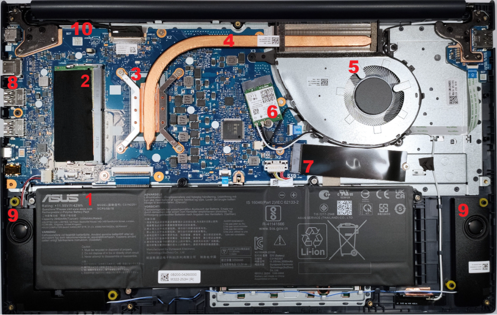

# Lab 3 — Teardown, and the same machine from the command line

Machine: my laptop (host), ASUS Vivobook 15 X1504VAP; Ubuntu guest `lab01` (VMware)
Date: 31.10.2026

## 1. The machine

**Exact model: ASUS Vivobook 15 X1504VAP** (also sold as F1504VA).

Found on the host with:
```
Get-CimInstance Win32_ComputerSystem | Format-List Manufacturer, Model, SystemFamily
```
Result: `Model : ASUS Vivobook 15 X1504VAP_F1504VA`. `Win32_BaseBoard` also says `Product : X1504VAP`.

**Sources:**
- ASUS User Manual (support page): https://www.asus.com/supportonly/x1504vap/helpdesk_manual/
- ASUS official tech specs: https://www.asus.com/laptops/for-home/vivobook/asus-vivobook-15-x1504/techspec/
- LaptopMedia teardown of the same model: https://laptopmedia.com/ca/guides/how-to-open-asus-vivobook-15-f1504-x1504-disassembly-and-upgrade-options/

ASUS does not publish a service manual with exploded views for this Vivobook, so I used the User Manual + the official spec page + a teardown of the same model (X1504 series), as the brief allows.

## 2. Components



*Figure 1. Photo from the LaptopMedia teardown of ASUS Vivobook 15 X1504. Numbers added by me.*

| # | What | Connects to | Limits |
|---|---|---|---|
| 1 | Battery, 42 Wh, 3-cell Li-ion (C31N2201) | Battery connector on the system board | 42 Wh fixed; screwed in, replaceable only with the same part |
| 2 | SO-DIMM slot, DDR4, the only slot (8 GB module inside) | CPU memory controller (`Controller1-ChannelA-DIMM0`) | DDR4-3200 only; other 8 GB is soldered; ASUS max 16 GB total |
| 3 | CPU, Intel Core 5 120U (under the cooling plate) | Soldered to the system board (BGA); heat pipe on top | 10 cores / 12 threads, 1.4–5.0 GHz; cannot be replaced |
| 4 | Copper heat pipe | CPU plate → radiator next to the fan | Only one heat pipe; limits long high-speed load |
| 5 | Cooling fan | Fan connector on the system board | One fan only; limits sustained performance |
| 6 | Wi-Fi 6 + Bluetooth 5.2 card | Small M.2 slot + two antenna cables | 1×1 (one antenna stream), Wi-Fi 6 not 6E; replaceable |
| 7 | SSD, M.2 2280 NVMe, 512 GB (Samsung) | M.2 slot, PCIe 4.0 x4, to the CPU | Only one M.2 slot, 2280 size only; no 2.5" bay |
| 8 | Ports: USB-C, HDMI, USB-A | Soldered to the system board | HDMI 1.4, USB 5 Gbps, one USB 2.0; no Thunderbolt |
| 9 | Two speakers | Audio connector on the system board | Small built-in speakers |
| 10 | System board `X1504VAP` | Everything above connects to it | CPU and 8 GB memory are soldered on it |

Sources for the table: ASUS spec page (memory, SSD, CPU, Wi-Fi, battery, ports), the teardown photo (layout, one fan, one heat pipe), and `windows-specs.txt` (memory locators, board name).

## 3. Upgrade verdict

| Component | ASUS says | Windows says | Verdict |
|---|---|---|---|
| Memory | 8 GB DDR4 on board + 1 SO-DIMM slot, max **16 GB** | `MemoryDevices` = 2 (8 GB + 8 GB), both `FormFactor` 12, DDR4 (26), 3200; `MaxCapacity` = **64 GB** | **No (officially):** the only slot is used and 16 GB is already the max. Swapping to a 16 GB module (24 GB total) is possible but not supported by ASUS. |
| Storage | 1 × M.2 2280 PCIe 4.0 x4 NVMe | `NVMe SAMSUNG MZVL8512HELU`, SSD, `BusType` RAID, 512 GB | **Yes:** replace with a bigger M.2 2280 NVMe drive (one slot only). |
| CPU | Core 5 120U, soldered (teardown: no socket) | `SocketDesignation` = U3E1 (not LGA) | **No:** soldered (BGA). |

**Where they disagree:**
- **Max memory:** Windows says 64 GB, ASUS says 16 GB. Windows only repeats the firmware (SMBIOS) table, which is often filled in carelessly. I trust ASUS.
- **Soldered memory:** Windows calls both memory devices SO-DIMM, but one is soldered (`Controller0-ChannelA`, no "DIMM" in the name). 2 devices ≠ 2 slots.
- **Disk bus:** Windows says RAID, but the disk is NVMe. It goes through Intel VMD (Rapid Storage), so Windows sees the controller in between.
- **CPU speed:** `MaxClockSpeed` = 1400 MHz is the base clock, not the 5.0 GHz turbo.

## 4. Two-OS table

Windows = my real laptop. Linux = my Ubuntu VM, so its values are **virtual**. No Mac in our pair.

| Fact | Windows (host) | Linux (VM) |
|---|---|---|
| CPU model | `Win32_Processor` Name = Intel Core 5 120U | `lscpu` Model name = Intel Core 5 120U |
| Physical cores | `Win32_Processor` NumberOfCores = 10 | `lscpu` Core(s) per socket × Socket(s) = 1 × 2 = 2 |
| Logical CPUs | `Win32_Processor` NumberOfLogicalProcessors = 12 | `lscpu` CPU(s) = 2 |
| Cache | `Win32_Processor` L2 = 6656 KB, L3 = 12288 KB | `lscpu` L2 = 2.5 MiB, L3 = 24 MiB |
| Total memory | `Win32_ComputerSystem` TotalPhysicalMemory = 16776159232 bytes (≈ 15.6 GiB) | `free -h` total = 1.6Gi |
| Memory type, speed | `Win32_PhysicalMemory` SMBIOSMemoryType = 26 (DDR4), Speed = 3200 | `dmidecode -t memory` Type = DRAM (EDO), Speed = Unknown |
| Memory slots | `Win32_PhysicalMemoryArray` MemoryDevices = 2 | `dmidecode -t memory` Number Of Devices = 64 |
| Disk is SSD? | `Get-PhysicalDisk` MediaType = SSD | `lsblk` ROTA = 1 (spinning) |
| Disk interface | `Get-PhysicalDisk` BusType = RAID | `lsblk` TRAN = spi |
| Motherboard | `Win32_BaseBoard` ASUSTeK, X1504VAP | `dmidecode -t baseboard` Intel Corporation, 440BX Desktop Reference Platform |

The names differ most for cores and disks: Windows has `NumberOfCores`, Linux makes you multiply two fields; Windows says `MediaType`/`BusType`, Linux says `ROTA`/`TRAN`. Units differ too (bytes and KB vs Gi and MiB).

Only the CPU name is the same in both, because VMware passes the real name through. Everything else in the VM is invented: 2 CPUs and 2 GB (what I gave it), a 1998 Intel 440BX board, EDO memory, 64 fake slots, and a "spinning" 25 GB disk that is really a file on my NVMe SSD. That is why Part A was done on the host.

## What I did

On the host, in PowerShell inside `evidence/`:
```
Start-Transcript -Path windows-specs.txt
Get-CimInstance Win32_ComputerSystem | Format-List Manufacturer, Model, SystemFamily
Get-CimInstance Win32_PhysicalMemoryArray | Format-List MaxCapacity, MemoryDevices
Get-CimInstance Win32_PhysicalMemory | Format-List DeviceLocator, Capacity, FormFactor, SMBIOSMemoryType, Speed
Get-CimInstance Win32_ComputerSystem | Format-List TotalPhysicalMemory
Get-CimInstance Win32_Processor | Format-List Name, SocketDesignation, NumberOfCores, NumberOfLogicalProcessors, MaxClockSpeed, L2CacheSize, L3CacheSize
Get-CimInstance Win32_BaseBoard | Format-List Manufacturer, Product
Get-PhysicalDisk | Format-List FriendlyName, MediaType, BusType, Size
Stop-Transcript
```
I selected only the needed fields, so no serial numbers are in the file.

In the Ubuntu VM:
```
lscpu > linux-specs.txt
free -h >> linux-specs.txt
sudo dmidecode -t memory | sed 's/Serial Number:.*/Serial Number: XXXX/' >> linux-specs.txt
lsblk -d -o NAME,MODEL,SIZE,ROTA,TRAN >> linux-specs.txt
sudo dmidecode -t baseboard | sed 's/Serial Number:.*/Serial Number: XXXX/' >> linux-specs.txt
```
`sed` replaces serial numbers with `XXXX`. Then I copied the file to the host with `scp ayaulym@192.168.245.129:linux-specs.txt .`

## What did not work the first time

- I typed `1scpu` (digit one) instead of `lscpu` (letter L) and got "command not found". I retyped it.
- I forgot `Get-PhysicalDisk` in the first transcript, so I ran `Start-Transcript -Append` and added it to the same file.
- ASUS has no public service manual for this model, so I used the spec page and a teardown photo instead.

## Evidence

- [evidence/manual-figures/inside-numbered.png](evidence/manual-figures/inside-numbered.png) — inside of the laptop with numbered parts
- [evidence/windows-specs.txt](evidence/windows-specs.txt) — commands and output on the real laptop
- [evidence/linux-specs.txt](evidence/linux-specs.txt) — commands output in the Ubuntu VM (virtual hardware)
