# How to build a test computer (two virtual machines)

**Who this is for:** someone who has never used VMware before.
**What you get:** two "test computers" that run inside one real computer — one with **Ubuntu Linux**, one with **Windows 11**. They can reach the internet and each other. If the developer breaks one, you can put it back to a clean state in a few seconds.
**Time:** about 2–3 hours the first time. Most of it is waiting while Windows installs.

---

## Before you start

You need:

| What | Why | Where to get it |
|---|---|---|
| A computer with **at least 16 GB of memory** and **about 100 GB free disk** | Both test computers together use 6 GB of memory and up to 89 GB of disk. The real computer needs the rest to keep working. | Check: Start → Settings → System → About (memory); File Explorer → This PC (free space) |
| **VMware Workstation Pro**, installed | This is the program that runs the test computers. It is free. | support.broadcom.com → My Downloads → Free Software Downloads → VMware Workstation Pro |
| **Ubuntu Server** installer file (`.iso`) | The Linux system. Free. | ubuntu.com/download/server |
| **Windows 11 Enterprise Evaluation** installer file (`.iso`) | The Windows system. Free and legal for 90 days, no licence key needed. | microsoft.com/evalcenter → Windows 11 Enterprise → ISO – Enterprise download, 64-bit, English |

> **Do not double-click the `.iso` files.** They are only for VMware. Double-clicking opens them on your real computer and may start reinstalling *your own* Windows.

> **If your computer has only 8 GB of memory:** use **1024 MB** instead of 2048 MB in step A6, and keep **4096 MB** for Windows. Close all other programs while the test computers are running.

**Two keys you will need all the time:**
- **Ctrl + Alt** — takes the mouse and keyboard back from the test computer to your real computer.
- Click inside the test computer's window — gives the mouse and keyboard to the test computer.

---

## Part A — The Ubuntu test computer

### A1. Start the wizard
In VMware: **File → New Virtual Machine…**

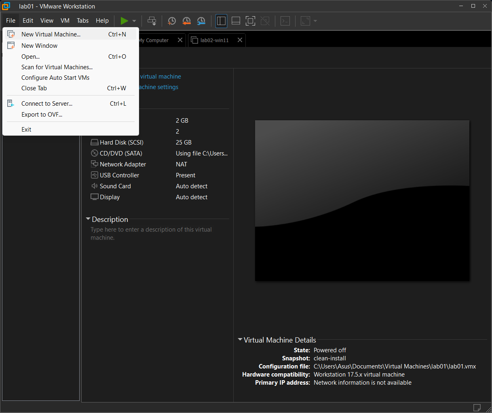

*Why:* the wizard asks a few questions and creates an empty test computer.

### A2. Choose "Typical"
Select **Typical (recommended)** → **Next**.

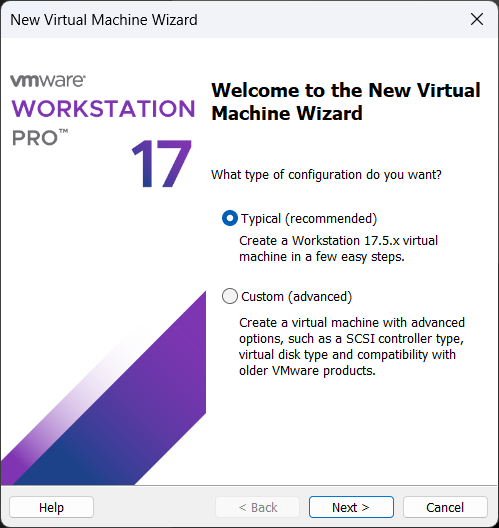

*Why:* "Custom" asks many technical questions. "Typical" uses safe defaults, and we change the few that matter later.

### A3. Choose the Ubuntu file
Select **Installer disc image file (iso)** → **Browse** → choose the Ubuntu `.iso` file you downloaded → **Next**.

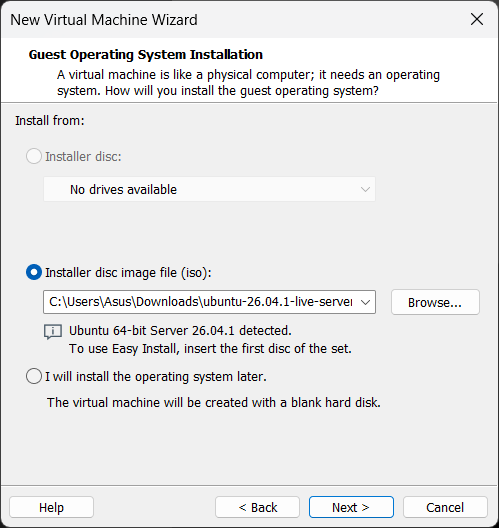

*Why:* this is the "installation disc". When the text under the box says **Ubuntu … detected**, VMware has recognised it.

### A4. Name it
Name: **test-ubuntu** → **Next**.

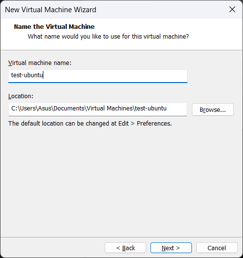

*Why:* a clear name, so you never mix it up with other test computers.

### A5. Disk size
Maximum disk size: **25 GB**. Select **Store virtual disk as a single file** → **Next**.


*Why:* 25 GB is enough for Ubuntu and the developer's work. The disk starts small and only grows when it is used, so it does not take 25 GB from your real computer at once. "Single file" is easier to copy or back up.

### A6. Memory, processors and network
On the summary screen click **Customize Hardware…** and set:

- **Memory: 2048 MB**

  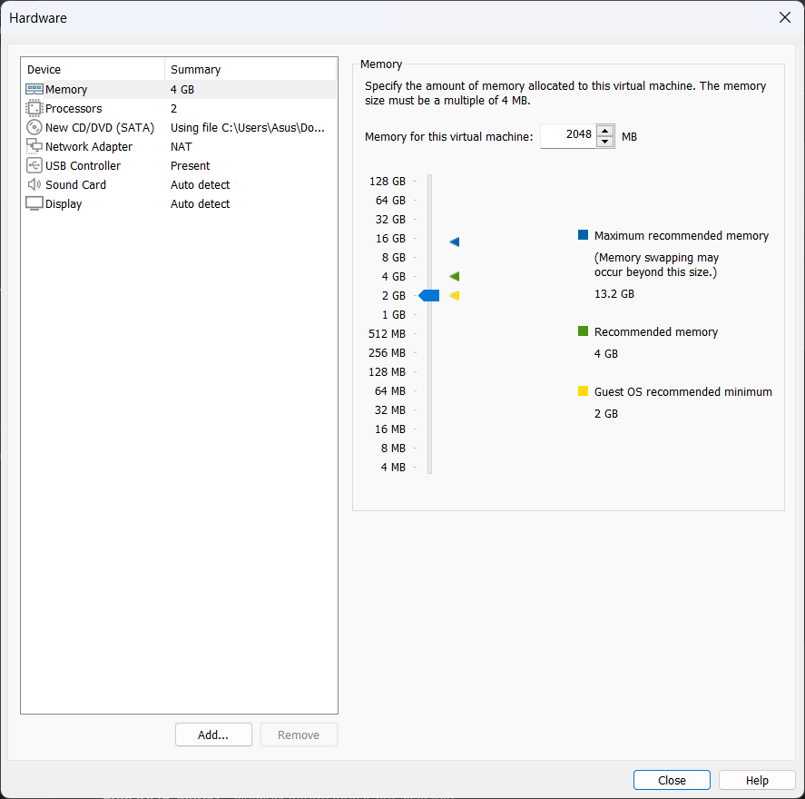

- **Processors: 2**

  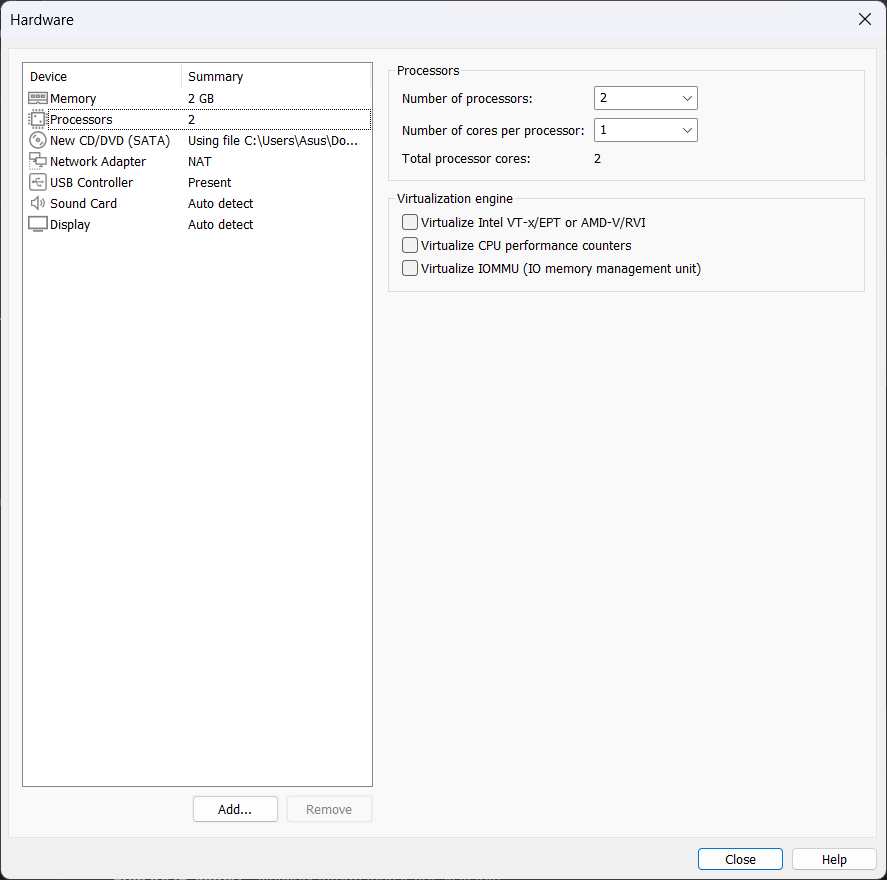

- **Network Adapter: NAT**

  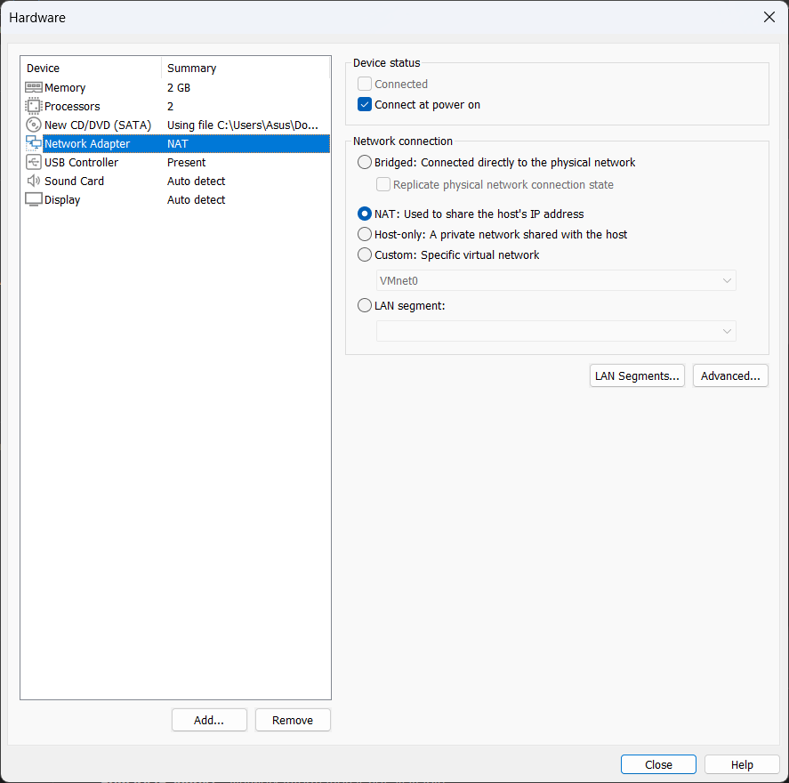

Click **Close**.

*Why:*
- **2 GB memory, 2 processors:** Ubuntu Server has no desktop, so it needs little. This leaves most of the memory for your real computer and the Windows test computer.
- **NAT:** the test computer gets the internet *through* your real computer, but it stays hidden from the office network. Not **Bridged** — on many office and campus networks unknown devices are blocked, and the test computer would get no internet. Not **Host-only** — it has no internet at all.

### A7. Check and finish
Check that the summary looks like this. **Untick "Power on this virtual machine after creation"** → **Finish**.

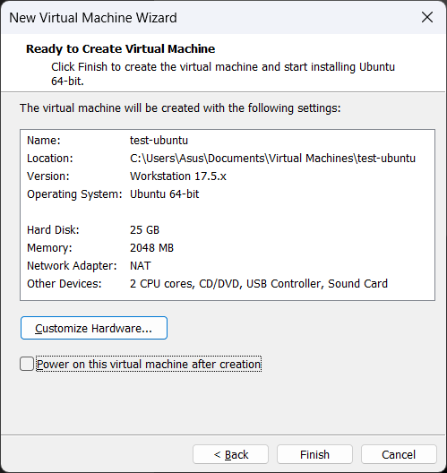

*Why:* we untick it so you can start the test computer yourself when you are ready.

### A8. Start it
Select **test-ubuntu** on the left → **Power on this virtual machine** (green triangle). If a black menu says *Try or Install Ubuntu Server*, press **Enter**.

> **If VMware asks about a "New USB Device"** (for example a fingerprint reader or camera): keep **Connect to the host**, tick **Remember my choice**, click **OK**. The test computer does not need it.

### A9. Language and keyboard
Press **Enter** on **English**. On the keyboard screen choose **Done**.
Use the **arrow keys** and **Tab** to move, **Enter** to choose, **Space** to tick a box. The mouse does not work in this installer.

### A10. Type of installation
Leave **Ubuntu Server** selected → **Done**.

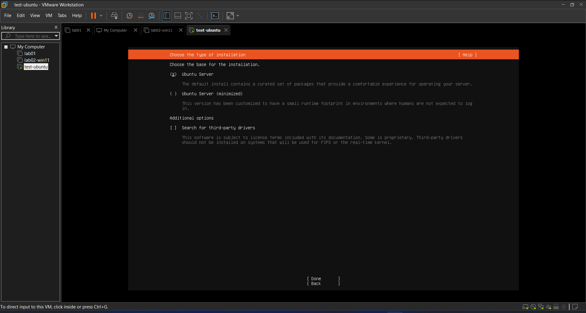

*Why:* the normal version, not "minimized" — the minimized version leaves out tools the developer will expect.

### A11. Network
You should see an address that starts with **192.168.** → **Done**.

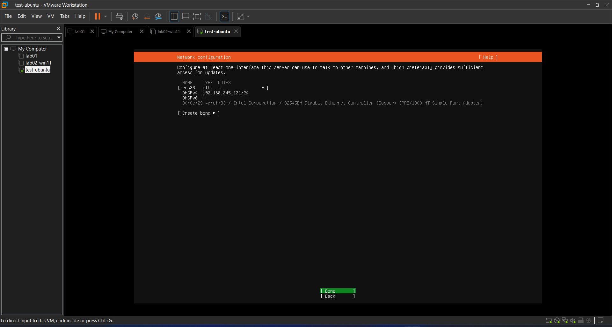

*Why:* this proves NAT works and the test computer has a network. If there is no address, go back to step A6 and check the network is NAT.

### A12. Proxy, mirror, storage
- **Proxy:** leave empty → **Done**.
- **Ubuntu archive mirror:** wait until the check at the bottom finishes → **Done**. This can take a few minutes. If it is still checking after about **10 minutes**, press **Done** anyway — the installer continues normally.
- **Guided storage configuration:** leave **Use an entire disk** → **Done**.
- **Storage configuration:** **Done**. A red box asks *Confirm destructive action* → **Continue**.

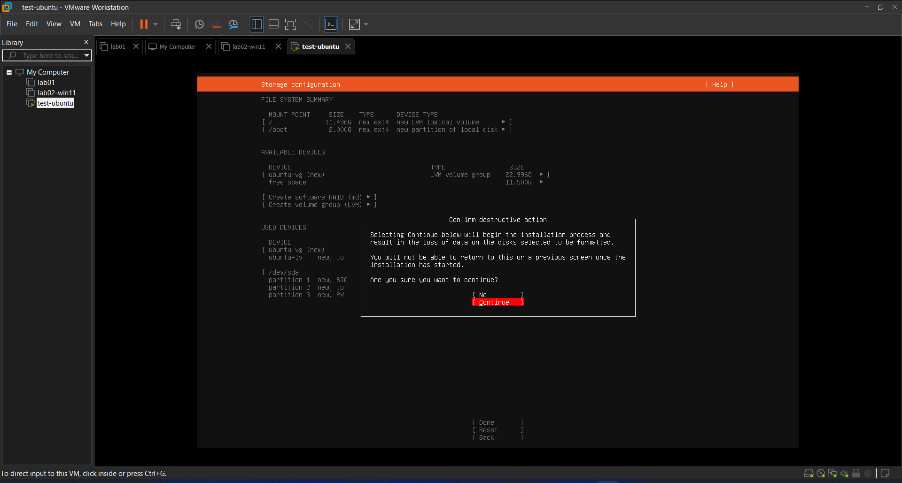

*Why it is safe:* "destructive" only means the **empty virtual disk** from step A5 is erased. Nothing on your real computer is touched.

### A13. User and password
Fill in:
- Your name: **student**
- Your server's name: **test-ubuntu**
- Pick a username: **student**
- Password: choose one and **write it down**. Do **not** use a password you use for email or the bank.

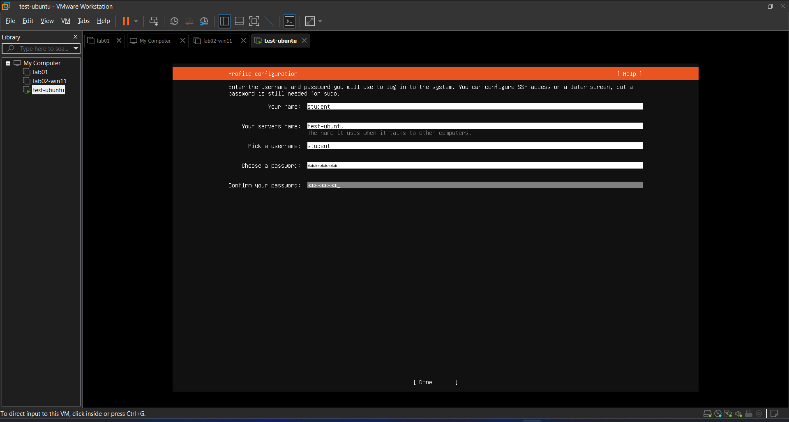

→ **Done**. On **Upgrade to Ubuntu Pro** choose **Skip for now** → **Continue**.

### A14. SSH
Move to **Install OpenSSH server** and press **Space** so it shows **[X]** → **Done**.

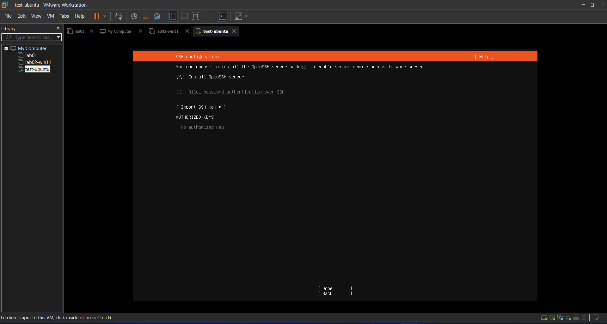

*Why:* SSH lets the developer (and you) connect to this test computer from another one and copy files. Without it, files cannot be moved in and out.

On **Featured server snaps** do not choose anything → **Done**.

### A15. Wait
The installer copies Ubuntu and then downloads updates ("Updating system"). This takes **5–20 minutes**. Do not press anything.

> You may see red lines at the bottom such as *soft lockup – CPU stuck*. This is a warning that the test computer was slow for a moment. **Just wait** — it continues by itself.

When the orange bar says **Installation complete!**, choose **Reboot Now** at the bottom.

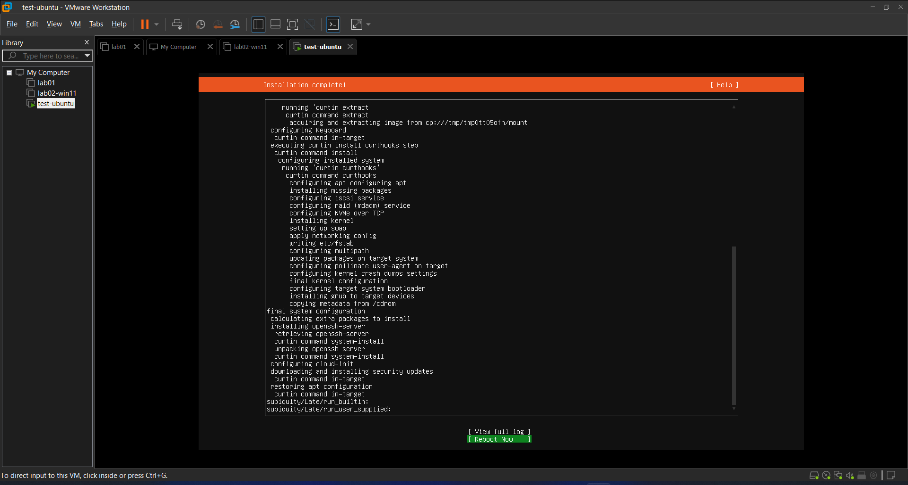

If you see *Please remove the installation medium, then press ENTER*, press **Enter**.

### A16. Log in
After the restart many lines with boxes and symbols may appear (security keys being created — only the first time). Press **Enter**, then type **student**, Enter, your password, Enter.

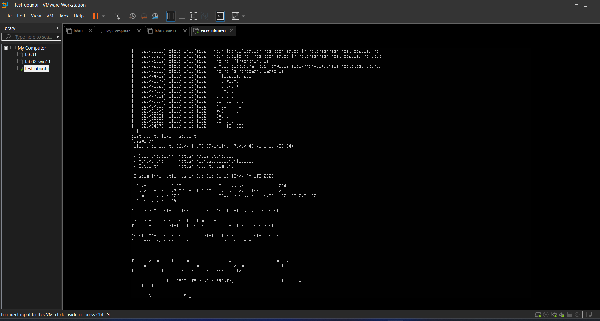

When you see `student@test-ubuntu:~$`, Ubuntu is ready.

### A17. Save a clean copy (snapshot)
Type `sudo shutdown now` and press Enter (type your password if asked). When it is off: **VM → Snapshot → Take Snapshot…**. Name: **clean-install** → **Take Snapshot**.

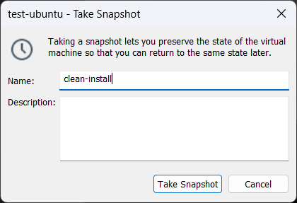

Check it in **VM → Snapshot → Snapshot Manager**:

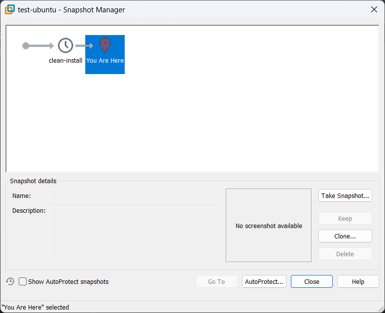

*Why:* this is a save point. **If the developer breaks Ubuntu**, open **Snapshot Manager**, select **clean-install**, click **Go To**, and the test computer is back to this exact moment.

---

## Part B — The Windows test computer

### B1. Start the wizard
**File → New Virtual Machine… → Typical → Next** (same as A1–A2).

### B2. Install the system later
Select **I will install the operating system later** → **Next**.

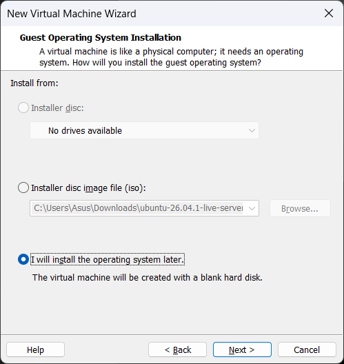

*Why:* for Windows, VMware's automatic installer can ask for a licence key. We add the Windows file ourselves in step B7 and install it by hand.

### B3. Windows 11
Guest operating system: **Microsoft Windows**. Version: **Windows 11 x64** → **Next**.

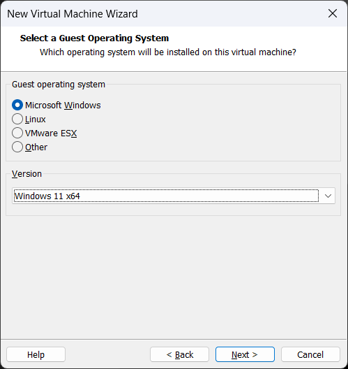

*Why:* this choice switches on what Windows 11 requires (modern firmware, Secure Boot and a security chip called TPM). Without it Windows 11 refuses to install.

### B4. Name it
Name: **test-win11** → **Next**.

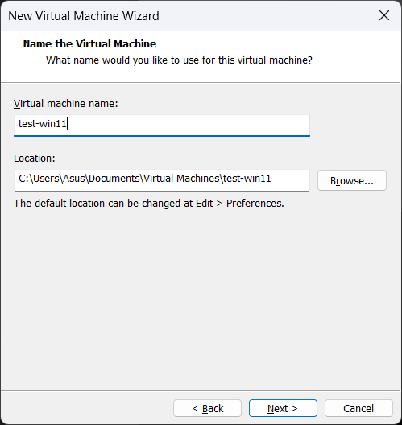

### B5. Encryption (TPM)
Select **Only the files needed to support a TPM are encrypted**. Keep the password VMware created and keep **Remember the password…** ticked → **Next**.

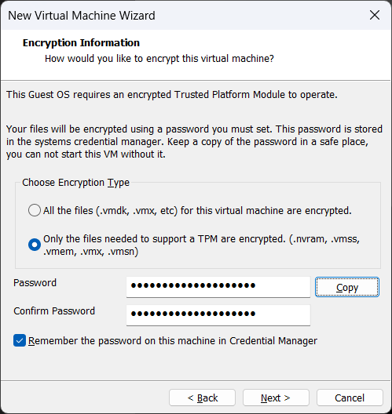

*Why:* Windows 11 needs a TPM. VMware stores this password for you, so you never have to type it. **Never move or delete single files from the test-win11 folder** — the TPM is part of it.

### B6. Disk size
**64 GB**, **Store virtual disk as a single file** → **Next**.

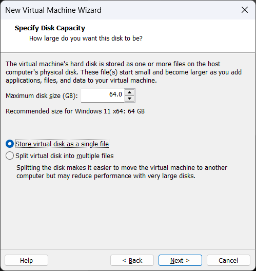

*Why:* 64 GB is the minimum Windows 11 accepts. Like Ubuntu, the disk grows only when it is used.

### B7. Memory, network and the Windows file
**Customize Hardware…** and set:

- **Memory: 4096 MB**

  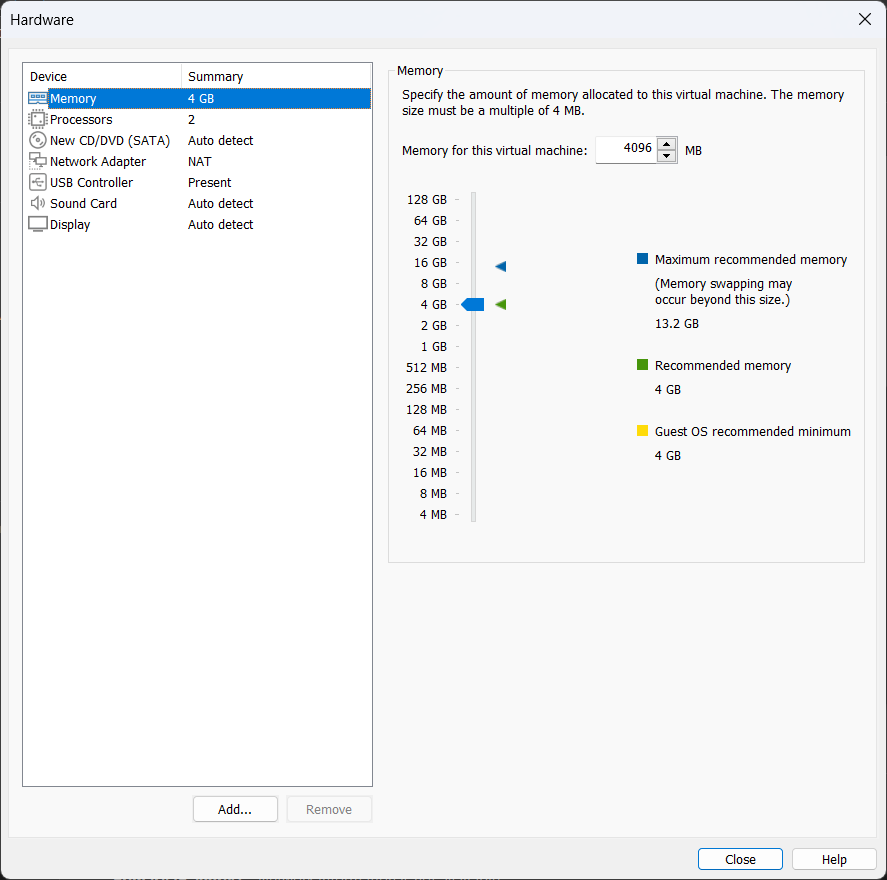

- **Processors: 2**
- **Network Adapter: NAT**

  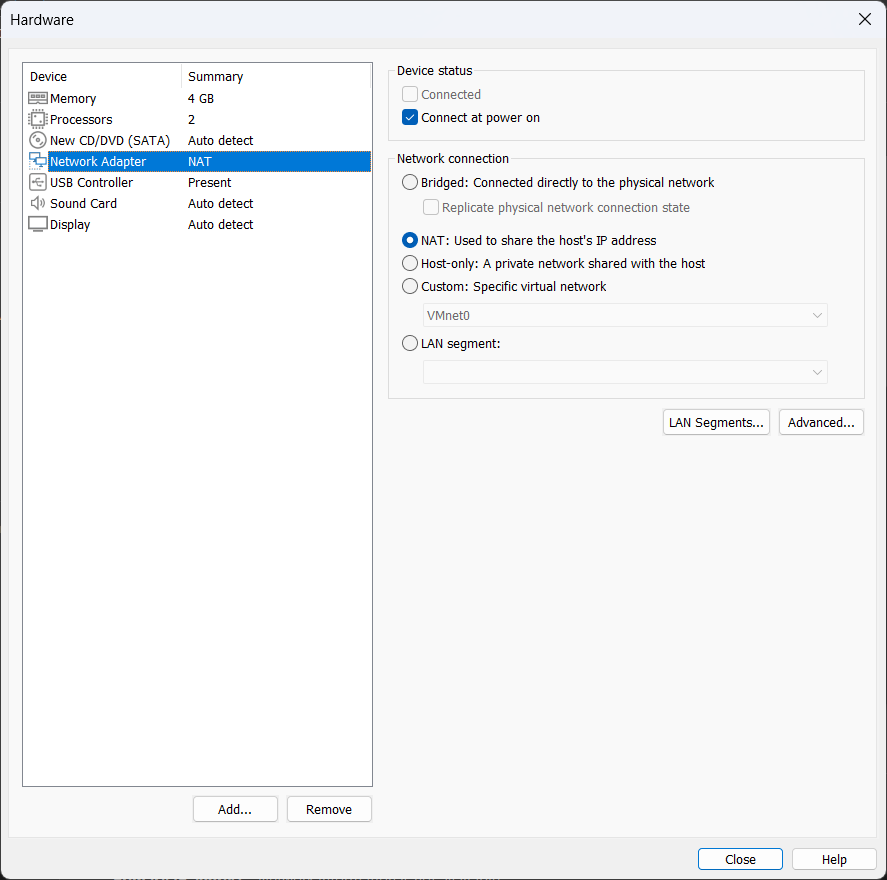

- **New CD/DVD** → **Use ISO image file** → **Browse** → choose the Windows `.iso` file.

  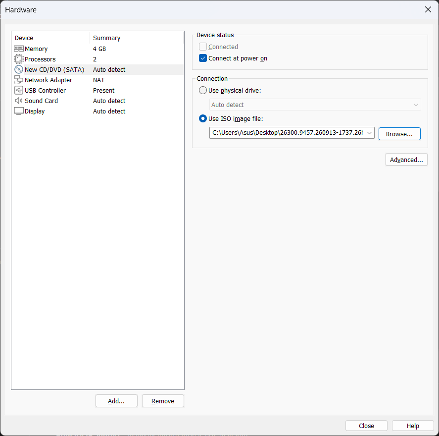

**Close** → **Finish**.

*Why:* 4 GB and 2 processors are the minimum for Windows 11. NAT — same reason as A6: internet, hidden from the office network, and both test computers end up on the same network so they can talk.

### B8. Start from the Windows file
Select **test-win11** → in the top menu **VM → Power → Power On to Firmware**. With the arrow keys choose **EFI VMware Virtual SATA CDROM Drive** → **Enter**, and **immediately press Space several times**.

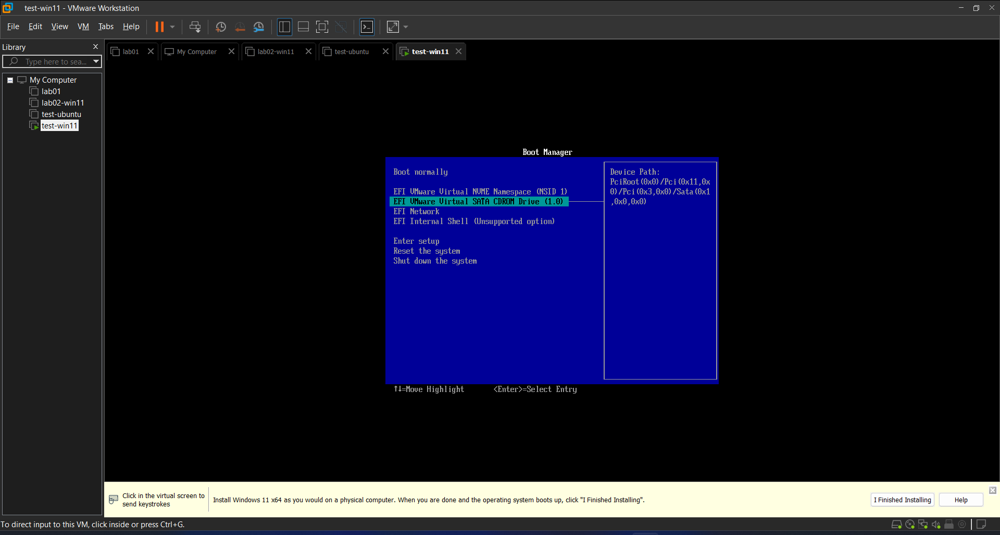

*Why:* Windows shows "Press any key to boot from CD" for only a few seconds. Starting this way gives you time. If you see *Time out*, do this step again and press Space faster.

### B9. Install Windows
- Language and keyboard: **Next**, **Next**.
- **Install Windows 11** and tick **I agree everything will be deleted** → **Next**.

  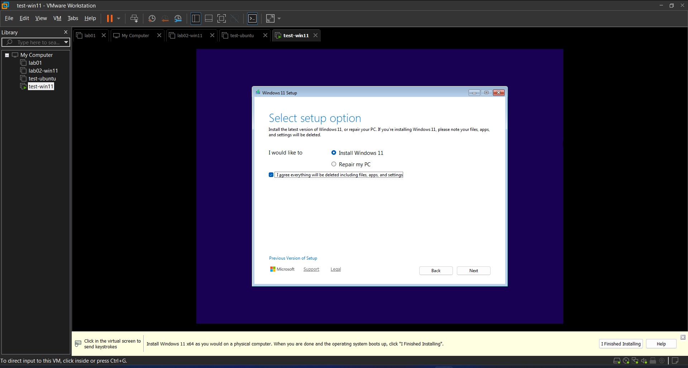

  *Why it is safe:* only the empty virtual disk is erased, not your real computer.
- It should **not** ask for a product key. If it does, you have the wrong file — stop.
- Licence: **Accept**.
- Choose **Disk 0 Unallocated Space** → **Next** → **Install**.

  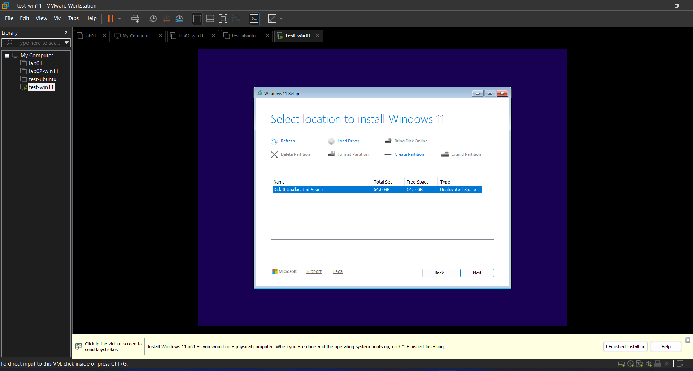

Windows installs for **20–30 minutes** and restarts by itself. If you see *Press any key to boot from CD* again, **do not press anything**.

### B10. Account — local, not Microsoft
After the restart: choose country and keyboard, **Skip** the second keyboard. When Windows asks you to sign in with Microsoft, click **Sign-in options → Domain join instead**. Enter the name **student**, a password (write it down), and three security questions (write the answers down).

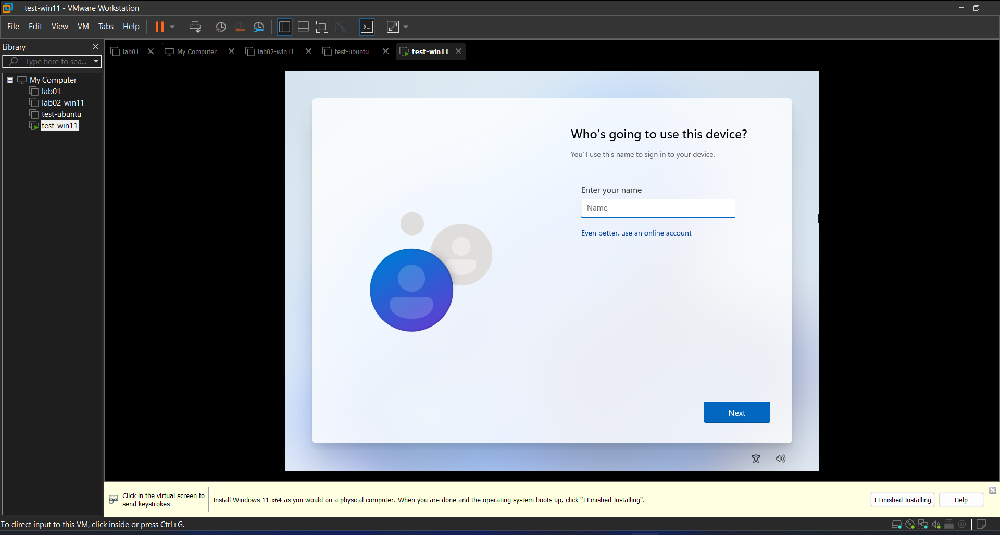

*Why:* a test computer should not be linked to anyone's personal Microsoft account. The security questions let you reset the password if it is forgotten.

### B11. Privacy
Switch **every option off** (scroll down to see all of them) → **Accept**. If Windows offers updates, choose **Update later**.


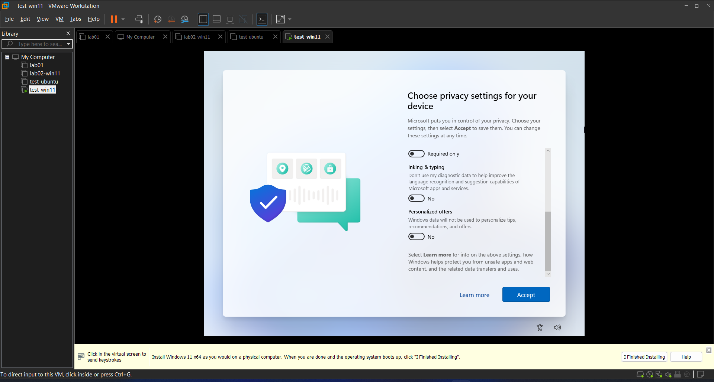

*Why:* the test computer does not need to send data to Microsoft. Windows updates itself later in the background.

### B12. Desktop
The bottom-right corner says **Windows 11 Enterprise Evaluation, valid for 90 days**. That is correct.

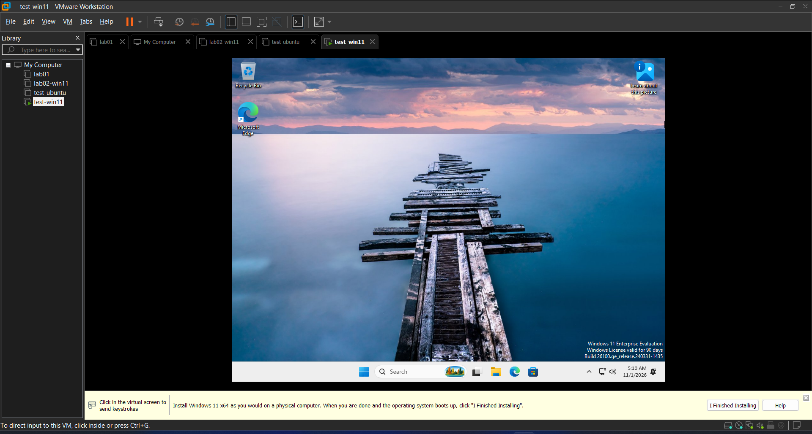

> **After 90 days** this Windows stops working normally. Then you go back to the snapshot (step B15) or build it again.

### B13. VMware Tools
In the top menu: **VM → Install VMware Tools**. When Windows asks *Do you want to allow this app…* (VMware installation launcher, VMware, Inc.) → **Yes**. In the installer: **Next → Typical → Next → Install → Finish**, then **Yes** to restart.

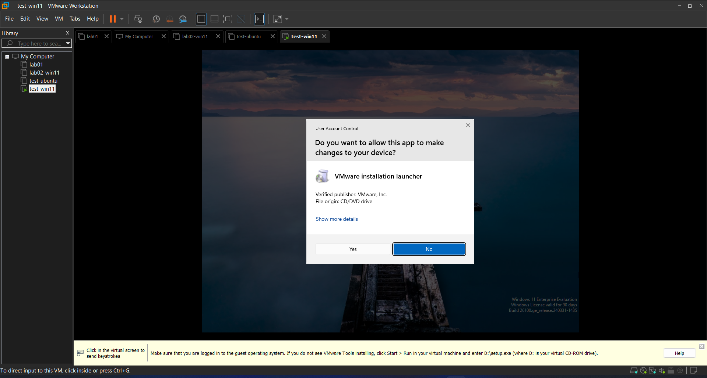

If nothing appears: open **File Explorer → This PC → DVD Drive "VMware Tools"** and run **setup64**.

*Why:* VMware Tools makes the screen fit the window and lets you copy and paste between the real computer and the test computer.

> If the window stays **black** after the restart: click inside and press a key. If it is still black, **VM → Power → Restart Guest** and wait a minute. Only if that does not help, **VM → Power → Reset**.

### B14. Allow ping from the other test computer
Inside Windows: right-click **Start → Terminal (Admin)** → **Yes**. Paste this line and press Enter:

```
New-NetFirewallRule -DisplayName "Lab02 - allow ping (ICMPv4 echo)" -Direction Inbound -Protocol ICMPv4 -IcmpType 8 -RemoteAddress LocalSubnet -Action Allow
```

You should see **Enabled : True**.

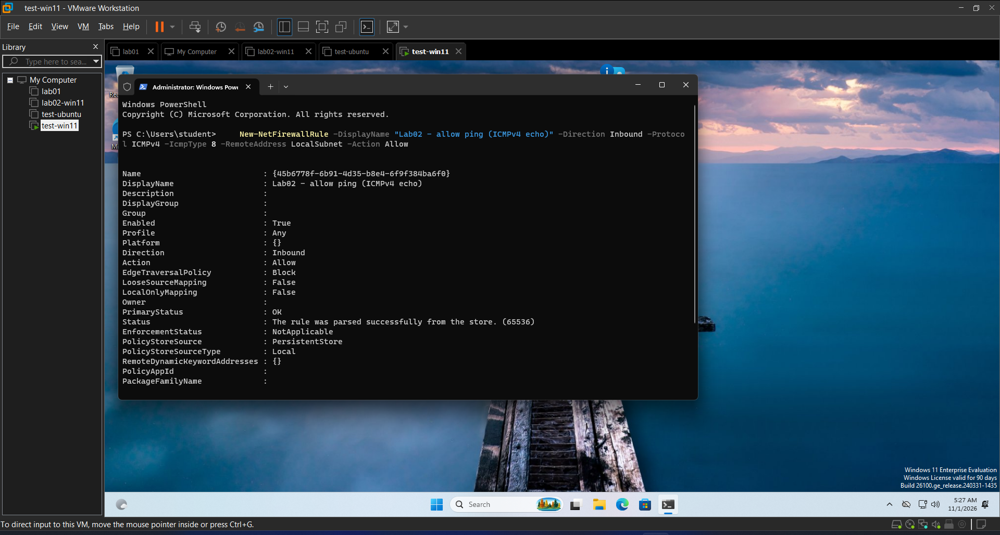

*Why:* by default Windows' firewall blocks "ping" (the simplest test that one computer can reach another). This rule allows **only** ping, and **only** from the local test network. **Do not turn the firewall off** — that would open everything, not just ping.

### B15. Save a clean copy (snapshot)
Shut Windows down (**Start → Power → Shut down**). Then **VM → Snapshot → Take Snapshot…**, name **clean-install** → **Take Snapshot**.

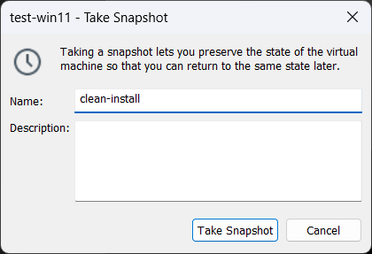

*Why:* same as A17 — one click brings Windows back to this clean state.

---

## Part C — Check that everything works

Start both test computers.

1. In **test-ubuntu** type `ip addr` and note the address after `inet` (not 127.0.0.1), for example `192.168.245.132`.
2. In **test-win11** open **cmd** (Start → type `cmd`) and type `ipconfig`. Note the **IPv4 Address**, for example `192.168.245.133`.
   The first three numbers must be the same on both.
3. In **test-win11** (cmd): `ping -n 4 <Ubuntu address>` → you should see **Reply from** four times.
4. In **test-ubuntu**: `ping -c 4 <Windows address>` → you should see **0% packet loss**.
5. On both: ping `8.8.8.8` → replies mean the internet works.

If step 4 fails, do step B14 again.

---

## If the developer breaks a test computer

Shut it down → **VM → Snapshot → Snapshot Manager** → select **clean-install** → **Go To** → **Yes**. It is back to the clean state.
